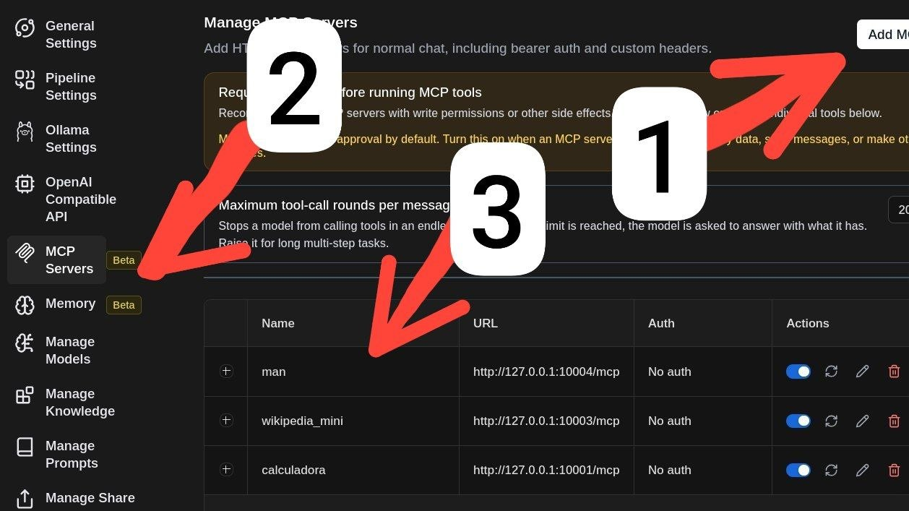
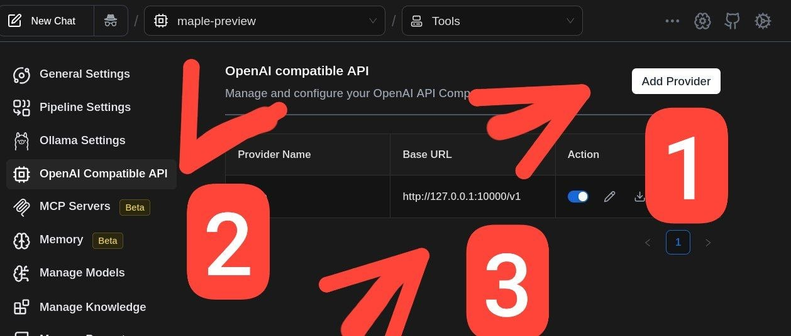

# 🍁 Maple CPU-ONLY: Motor de IA Local para Linux

[](#) 
[](README_EN.md)

[Español 🇪🇸](README.md) | [English 🇬🇧](README_EN.md)

**Maple CPU-ONLY** es una colección de scripts automatizados diseñados para simplificar al máximo la instalación del modelo de IA **Maple-preview** junto con un ecosistema de servidores **MCP (Model Context Protocol)** en sistemas Debian y derivados.

Junto con **Page Assist** (el famoso plugin para Firefox y Chrome), obtendrás una estación de trabajo de IA local sumamente rápida, privada y **sin alucinaciones**, todo ello **sin necesidad de tarjetas gráficas NVIDIA**. El motor está compilado específicamente para funcionar al máximo rendimiento usando únicamente la CPU.

---

## ⚡ Características Principales y Requisitos

- **Sin necesidad de GPU:** Compilado y optimizado exclusivamente para ejecución por CPU mediante `llama.cpp`.
- **Rendimiento Ultrarrápido:** Funciona con fluidez en equipos convencionales de gama media.
- **Precisión Total (Sin Alucinaciones):** Integra servidores de herramientas locales (MCP) que la IA consulta en tiempo real en lugar de adivinar o inventar información.

### 💻 Requisitos del Sistema
- **Sistema Operativo:** Debian 12 / Debian 13 (o distribuciones derivadas como Ubuntu o Linux Mint). *Probado con éxito en Debian 12 y 13.*
- **Procesador (CPU):** Intel Core i5 de 8ª generación en adelante (o equivalente AMD Ryzen).
- **Memoria RAM:** 16 GB de RAM (admite DDR4).
- **Espacio en Disco:** Aproximadamente 10 GB libres.

---

## 🛠️ Servidores MCP Incluidos (Model Context Protocol)

Para prevenir errores de cálculo y alucinaciones en el modelo, el instalador configura 3 (próximamente 4) servidores MCP útiles que Page Assist puede invocar automáticamente:

1. **📚 Wikipedia Local MCP:** Descarga una versión ligera y comprimida de Wikipedia en local. La IA realiza consultas de manera autónoma para verificar datos reales antes de responder.
2. **🧮 Calculadora de 60 Dígitos MCP:** Un motor matemático de alta precisión (hasta 60 dígitos) para evitar cualquier tipo de error de cálculo aritmético por parte de la IA.
3. **🐧 Manuales de Linux (Man Pages) MCP:** Permite a la IA leer directamente los manuales de los comandos instalados en tu propio sistema Linux, garantizando sintaxis y parámetros exactos en la terminal.

---

## 🚀 Guía de Instalación Rápida

La instalación es prácticamente automática (a excepción de la configuración del plugin en el navegador).

### 1. Clonar el Repositorio
Abre tu terminal y clona el repositorio (o descarga y extrae el archivo ZIP):

```bash
git clone https://github.com/maxlinux2000/Maple-CPU-ONLY.git
cd Maple-CPU-ONLY
```

### 2. Ejecutar el Instalador
Lanza el script principal de instalación:

```bash
bash install.sh
```

> **Nota:** El script solicitará tu contraseña de `sudo` para instalar las dependencias faltantes del sistema. Posteriormente compilará `llama.cpp`, descargará el modelo Maple, configurará los 3 servidores MCP y dejará el entorno listo en la carpeta `~/maple` de tu usuario.

---

## 🌐 Configuración en el Navegador con Page Assist

Maple se utiliza de forma cómoda e intuitiva a través del navegador web utilizando la extensión **Page Assist**.

1. **Instala la extensión Page Assist:**
   - [Page Assist en Chrome Web Store](https://chromewebstore.google.com/detail/page-assist-a-web-ui-for/jfgfiigpkhlkplamclnakgahicfffkgw)
   - [Page Assist en Firefox Add-ons](https://addons.mozilla.org/es/firefox/addon/page-assist/)

2. **Configura Page Assist paso a paso:**
   Sigue la guía visual de imágenes ubicada en la carpeta `images/` de la raíz del proyecto:

   - **Paso 0:** Abre la configuración de Page Assist y apunta el endpoint/servidor de API a la dirección del motor Maple local.
     

   - **Paso 1:** Activa la integración de herramientas / MCP en el panel para habilitar el acceso a los servidores de Wikipedia, Calculadora y Manuales de Linux.
     

   - **Paso 2:** Abre un nuevo chat, selecciona el modelo Maple y comienza a interactuar directamente desde tu navegador.
     

---

## 📄 Licencia y Enlaces

- Repositorio Oficial: [https://github.com/maxlinux2000/Maple-CPU-ONLY.git](https://github.com/maxlinux2000/Maple-CPU-ONLY.git)
- Motor de Inferencia: [llama.cpp](https://github.com/ggerganov/llama.cpp)
- Interfaz web: [Page Assist](https://github.com/nomic-ai/page-assist)